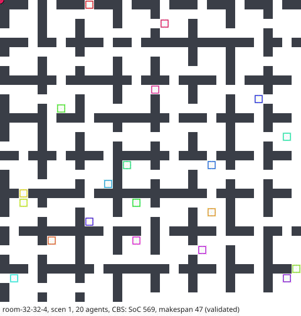

# mapf-fleet-planner

A C++20 library that plans collision-free paths for a fleet of robots on a grid (multi-agent
path finding, MAPF), with Python bindings. It ships three planners (prioritized planning, optimal
Conflict-Based Search, and bounded-suboptimal ECBS), an independent solution validator, a
benchmark on the standard MovingAI maps, a profiled low-level search, and an animated replay.

## Why it is hard

- **The joint search space explodes.** With 100 agents the joint state space is astronomically
  large; CBS avoids it by splitting on conflicts, but its constraint tree still grows
  exponentially on tightly coupled maps. In this benchmark CBS stops scaling at 10-40 agents.
- **Correctness is subtle.** "Stay at goal" semantics, edge (swap) conflicts, and a search that
  must terminate when no path exists under the constraints all need care. Every plan is checked by
  a separate validator that shares no code or types with the planners, and the optimal planner is
  checked against a brute-force joint-state Dijkstra on small maps.
- **Fair performance work.** All three search optimisations are runtime switches over one
  templated search, and every variant expands exactly the same states, so before/after numbers
  measure implementation cost only.

## Demo



`docs/replay.svg` is an animated SVG (SMIL, 36 KiB) of 20 agents on `room-32-32-4`, generated
through the Python bindings. The plan is validated before the file is written. To regenerate it:

```bash
scripts/download_movingai.sh
make replay          # needs python3 with pybind11
```

Compare all planners on one instance from Python:

```bash
make python
PYTHONPATH=build/release python3 python/examples/plan_room.py room-32-32-4 1 20
```

## Quick start

Requirements: CMake, Ninja, a C++20 compiler, Python 3 (only for the scripts and bindings).

```bash
scripts/download_movingai.sh     # MovingAI maps + scenarios, ~4 MB (ODC-By, see data/README.md)
make build                       # release build: libmapf, validator, mapf_bench, mapf_profile
make test                        # GoogleTest suite under ASan + UBSan
make pytest                      # pybind11 module mapf_py + smoke test
make reproduce                   # benchmark (serial) + profile, ~20 min
make format-check                # clang-format, as in CI
```

C++ API (`include/mapf/planner.hpp`):

```cpp
mapf::Instance inst = mapf::load_instance("data/maps/room-32-32-4.map",
                                          "data/scen/room-32-32-4-random-1.scen", 20);
mapf::Result r = mapf::plan_ecbs(inst, 1.5, mapf::Budget{10.0});
// also plan_prioritized(inst, budget) and plan_cbs(inst, budget)
```

### Using it from another CMake project

```cmake
add_subdirectory(path/to/mapf-fleet-planner)   # tests and tools default to OFF here
target_link_libraries(my_app PRIVATE mapf::mapf mapf::validator)
```

`cmake --install` also installs the static libraries, headers and a package config for
`find_package(mapf_fleet_planner)`. This is the documented route for project 1
(terminal-digital-twin) to link the planner behind its `IPathPlanner` interface; that link has
not been made yet.

## Key results

Benchmark (run A): 5 MovingAI maps, 10-100 agents, 10 random scenarios each, 4 planners, 10 s
per instance, 2,000 runs. Every solved plan (1,416) was re-checked by the validator: 0 invalid.
Source: `results/bench_summary.md`.

Largest agent count with at least 50 % success:

| map | PP | CBS | ECBS w=1.2 | ECBS w=1.5 |
|---|---|---|---|---|
| empty-32-32 | 100 | 40 | 100 | 100 |
| maze-32-32-2 | 20 | 10 | 60 | 100 |
| random-32-32-20 | 100 | 30 | 100 | 100 |
| room-32-32-4 | 50 | 20 | 60 | 100 |
| warehouse-10-20-10-2-1 | 100 | 40 | 100 | 100 |

Solution quality (mean sum of costs / CBS optimum, on instances both solved): ECBS w=1.5 is at
most 1.0213 and ECBS w=1.2 at most 1.0185 across all maps; PP goes up to 1.1287 (empty-32-32,
60 agents).

Low-level search profile (run B, single process pinned to one core, median of 5; source:
`results/profile.md`):

| variant | PP Mnodes/s | speed-up PP / CBS / ECBS | PP peak RSS |
|---|---:|---:|---:|
| baseline: std::set, AoS, heap allocation | 1.20 | 1.00x / 1.00x / 1.00x | 49.6 MiB |
| binary heap | 1.30 | 1.09x / 1.17x / 1.20x | 49.5 MiB |
| bucket queue | 1.61 | 1.35x / 1.21x / 1.18x | 52.1 MiB |
| bucket + arena (default) | 1.89 | 1.58x / 1.32x / 1.24x | 75.5 MiB |
| bucket + SoA | 1.61 | 1.35x / 1.19x / 1.16x | 45.7 MiB |

## Limitations

- CBS is the plain algorithm: no bypassing, prioritized (cardinal) conflicts or CBSH heuristics,
  which is why it stops at 10-40 agents.
- Run-A runtimes were measured with 10 parallel groups and are noisy; compare planners by success
  rate. Clean single-threaded timings are in `results/profile.md`.
- The struct-of-arrays node layout gave no gain; it is kept as an off-by-default switch.
- The arena raises peak memory (PP: 52.1 to 75.5 MiB against the bucket-queue run).
- CI (`.github/workflows/ci.yml`) is written but has not run on GitHub yet.
- Lifelong (online task arrival) mode is not implemented.
- Results are reported as tables; no plots are generated.

## Target roles

- **PSA Corporation**: fleet path planning for terminal AGVs, a reusable C++ library with a
  CMake package, and a visual replay.
- **Griffin Labs (LionsBot)**: multi-robot path planning in C++ and Python, tested under
  sanitizers and verified by an independent checker.
- **HTX RAUS**: motion planning for many unmanned agents, with a measured scaling study.
- **Accenture**: clean, tested, packaged engineering with CI and reproducible results.

## Layout

| path | contents |
|---|---|
| `include/mapf/`, `src/` | grid, instance loading, low-level search, PP, CBS/ECBS |
| `validator/` | independent plan checker (standard library only) |
| `bench/` | benchmark and profile executables, planner-to-validator adapter |
| `python/` | pybind11 module `mapf_py`, examples, pytest smoke test |
| `scripts/` | data download, benchmark runner, summary, profiler |
| `tests/` | GoogleTest suite, brute-force reference |
| `results/` | benchmark CSV and summary, profile tables |

Docs: [features](docs/FEATURES.md), [design](docs/DESIGN.md),
[interview notes](docs/INTERVIEW_NOTES.md), [decisions](DECISIONS.md).
Data: MovingAI MAPF benchmark (Stern et al., SoCS 2019), ODC-By licence, not committed.
