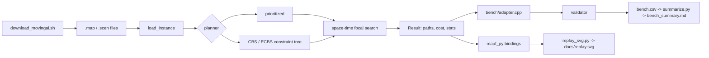

# Features

## Tech stack

| language / tool | used for |
|---|---|
| C++20 | the planning library, validator, benchmark and profile executables |
| CMake + Ninja (presets `release`, `asan`) | build, install, `find_package` package config |
| GoogleTest 1.15.2 (FetchContent) | unit, brute-force and property tests |
| AddressSanitizer + UBSan | the test build (`make test`) |
| `std::pmr::monotonic_buffer_resource` | the per-thread arena for search nodes and queues |
| pybind11 2.13.6 | the Python module `mapf_py` |
| Python 3 (standard library only) | benchmark summary, profiler driver, SVG replay generator |
| pytest | Python smoke test |
| Bash | data download and benchmark runner scripts |
| clang-format | formatting check |
| GitHub Actions | CI workflow (written, not yet run on GitHub) |
| MovingAI MAPF benchmark (ODC-By) | maps and scenarios |

## End-to-end workflow

A MovingAI `.map` and `.scen` file are parsed into an `Instance` (a grid plus one start and goal
per agent). The caller picks a planner: prioritized planning, CBS or ECBS. Each of them repeatedly
calls the same single-agent space-time search, and CBS/ECBS add a high-level constraint tree that
splits on conflicts between agents. The resulting paths go through an adapter into the separate
validator, which checks them on its own. The benchmark runner writes every run to a CSV that a
summary script turns into tables; the profiler re-runs fixed instance groups under each search
variant; and the Python bindings expose the same load, plan and validate calls to scripts such as
the SVG replay generator.

## Map and scenario loading

Reads MovingAI `.map` files (`.`, `G`, `S` are free, everything else is an obstacle) into a
4-connected `Grid`, and keeps the first N lines of a `.scen` file as an N-agent instance. The
scenario file's octile optimal-length column is ignored because planning is 4-connected. Bad input
(too few entries, out-of-range or blocked coordinates, mismatched map size) throws
`std::runtime_error` with a message naming the problem. Lives in `include/mapf/grid.hpp`,
`include/mapf/instance.hpp`, `src/grid.cpp` and `src/instance.cpp`; tested in `tests/test_io.cpp`.

## Single-agent space-time search

One search serves all planners: a focal search over (cell, time) states. With w = 1 it is A*
that breaks ties on f by the fewest soft conflicts in a conflict-avoidance table, then by depth.
The heuristic is the exact BFS distance to the goal, maxed with the time of the last constraint
on the goal cell. A horizon of last constraint time plus the number of free cells plus one makes
"no path exists" terminate. Lives in `src/low_level.cpp`, `src/space_time.cpp` and
`src/space_time.hpp`; tested in `tests/test_low_level.cpp`.

## Prioritized planning (baseline)

Plans agents one at a time in scenario order; each agent's path is reserved and later agents
must avoid it. It is fast but incomplete, so it returns `Status::Failed` (not `Infeasible`) when
an agent finds no path. Entry point `plan_prioritized` in `include/mapf/planner.hpp`,
implemented in `src/prioritized.cpp`.

## Conflict-Based Search (CBS) and ECBS

One engine handles both. The high level searches a tree of constraint sets; at each node it finds
the earliest vertex or edge (swap) conflict and branches into two children, each forbidding one
agent from that cell or move at that time. Each node stores only the replanned agent's path and
constraint, and full state is rebuilt by walking to the root. ECBS keeps a FOCAL list of nodes
within w times the lowest bound, ordered by conflict count, which guarantees a sum of costs at
most w times optimal. With w = 1 the engine is plain optimal CBS. Entry points `plan_cbs` and
`plan_ecbs`; implemented in `src/cbs.cpp` with hash-based conflict detection in
`src/conflicts.cpp`; tested in `tests/test_planners.cpp`.

## Clear result statuses and budgets

Every call returns a `Result` with a `Status` (`Solved`, `Infeasible`, `Failed`, `TimeLimit`,
`NodeLimit`), paths only when solved, sum of costs, makespan, a proven lower bound and node and
call counters. A `Budget` sets a wall-clock and a high-level node limit. Duplicate starts or goals
are reported as `Infeasible` without searching. Defined in `include/mapf/planner.hpp`.

## Independent validator

A separate library with no planner code or types. It uses (x, y) positions, its own adjacency and
obstacle checks, a plain pairwise check for vertex and edge conflicts, and its own cost
computation. `bench/adapter.cpp` is the only bridge to the planner types. The benchmark runner
re-checks every solved plan and exits non-zero on any invalid one. Lives in `validator/`; tested
in `tests/test_validator.cpp`.

## Brute-force and property tests

`tests/brute_force.hpp` runs Dijkstra over joint states (all positions plus a "finished" bit per
agent) to get the true optimum on 3x3 and 4x4 maps with 2-3 agents, and `tests/test_brute_force.cpp`
checks that CBS matches it (a clean `NodeLimit` is allowed on at most 3 instances, a wrong cost
never). `tests/test_property.cpp` runs many random grids and checks that every plan passes the validator
with matching costs, that no planner beats CBS, that ECBS stays within w of it, and that the
planners agree on solvability.
The suite runs under ASan + UBSan via `make test`.

## Search tuning switches

`SearchTuning` selects the OPEN list (`std::set`, binary heap with lazy deletion, or a bucket
queue indexed by integer f), the node layout (array of structs or struct of arrays) and whether
an arena is used. The search is a template over node storage and queue type, with 6
instantiations dispatched per call. All queue keys are total orders, so every variant expands
exactly the same states; `tests/test_tuning.cpp` checks equal plans and node counts for all 12
combinations. Defaults: bucket queue, AoS, arena on. Declared in `include/mapf/planner.hpp`,
implemented in `src/low_level.cpp`.

## Benchmark runner and summary

`scripts/run_benchmark.sh` drives `mapf_bench` (`bench/bench_main.cpp`) over 5 maps, 10-100
agents, 10 scenarios and 4 planners with a 10 s limit, stopping a (map, planner) series early
after a count where it solves none. `scripts/summarize.py` writes success rates, median runtimes,
the largest count with at least 50 % success and sum-of-costs ratios against CBS to
`results/bench_summary.md`.

## Profiler

`scripts/profile.py` runs `mapf_profile` (`bench/profile_main.cpp`) over fixed instance groups,
each run a fresh process pinned to one CPU with `taskset`, 5 interleaved reps, node limit only so
work is identical. It reports wall time, nodes per second and peak RSS for every tuning
combination, asserts equal work per group, and writes `results/profile.md`.

## Python bindings

The `mapf_py` module exposes `load_map`, `load_instance`, `make_instance`, `plan` and `validate`
using plain Python types: `(x, y)` tuples, lists and dicts, with no numpy dependency. The GIL is
released while planning, and `validate` calls the independent validator. Built with
`make python` (`-DMAPF_BUILD_PYTHON=ON`). Lives in `python/bindings.cpp`, with
`python/examples/plan_room.py` and `python/tests/test_smoke.py`.

## Animated replay

`python/examples/replay_svg.py` plans an instance through the bindings, validates it, and writes
an animated SVG using SMIL with only the standard library. The committed `docs/replay.svg` shows
20 agents on `room-32-32-4` in 36 KiB. Run with `make replay`.

## Packaging and CI

`add_subdirectory` plus `mapf::mapf` and `mapf::validator` lets other CMake projects use the
library; tests and tools default to off when it is not the top-level project, and warning and
sanitizer flags are kept private. `cmake --install` provides `find_package(mapf_fleet_planner)`.
`.github/workflows/ci.yml` runs the format check, the sanitizer tests and the Python smoke test
on one cached map; it has not yet run on GitHub. See `CMakeLists.txt` and `Makefile`.
